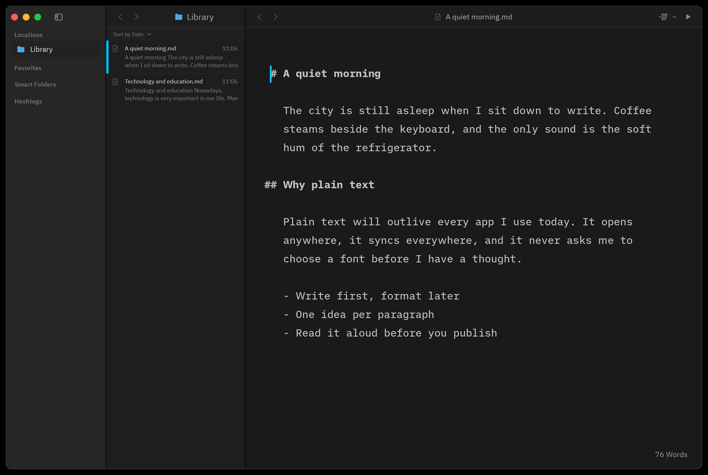
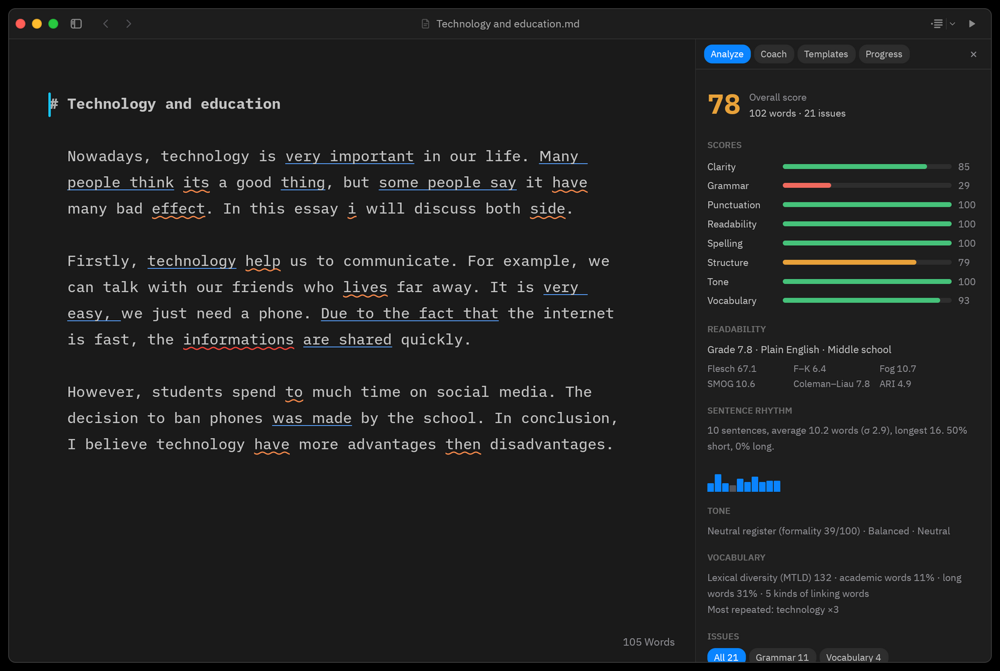
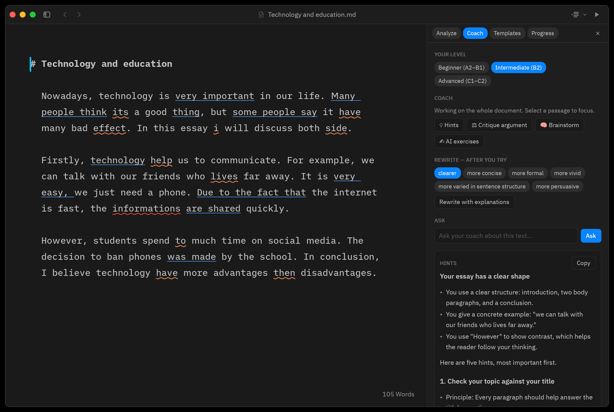

<p align="center">
  
</p>

<h1 align="center">Quill</h1>

<p align="center">
  A free, open-source alternative to iA Writer for Linux, with a built-in writing coach.<br>
  Native app written in Rust with <a href="https://www.gpui.rs">GPUI</a>.
</p>

<p align="center">
  
</p>

> Quill is an independent project inspired by iA Writer. It is not affiliated with or endorsed by Information Architects Inc.

## Features

**Writing**
- Distraction-free Markdown editor with the iA Writer Mono, Duo and Quattro fonts
- Focus Mode (sentence or paragraph) and Typewriter Mode
- Syntax highlight (adjectives, nouns, verbs…) and Style Check (fillers, clichés, redundancies)
- Spell checking, smart quotes, list continuation, tables, footnotes, `==highlight==`, `[[wiki links]]`
- Authors: keeps track of text pasted from AI versus written by you

**Library and output**
- Library sidebar with folders, favorites, hashtags, filter and Quick Search
- Autosave to plain `.md` files; picks up changes from Dropbox, Nextcloud or Syncthing
- Live preview with 6 templates
- Export to PDF, HTML, Word (DOCX) and plain text; publish to WordPress, Ghost, Micro.blog and Medium
- `quill://` URL commands (same set as `ia-writer://`)

**Writing Studio** (press <kbd>F7</kbd>): helps you become a better writer, not just fixes your text

| Tab | What it does |
|---|---|
| **Analyze** | Checks grammar, spelling, punctuation, vocabulary, sentence structure, clarity, tone and readability, all offline. Every finding comes with a short lesson and examples. The fix stays hidden until you have tried it yourself. |
| **Coach** | Uses Claude to explain mistakes, give hints, critique your argument, brainstorm, score against a rubric (IELTS bands), or rewrite with every change explained. |
| **Templates** | IELTS Task 1 and 2, argumentative essay, blog post, technical design doc, how-to guide, short story. Each comes with a skeleton, a timer and a live checklist, and you can edit any template as a Markdown file. |
| **Progress** | Tracks your recurring mistakes, weakest areas and progress over time, and builds practice exercises from your own sentences. All data stays on your computer. |

<p align="center">
  
  
</p>

## Setup

### 1. Install the dependencies

Rust 1.92 or newer ([rustup.rs](https://rustup.rs)), plus the libraries GPUI needs. On Debian or Ubuntu:

```sh
sudo apt install build-essential pkg-config libxkbcommon-x11-dev libwayland-dev \
  libx11-xcb-dev libfontconfig-dev libvulkan1 mesa-vulkan-drivers
```

On Fedora:

```sh
sudo dnf install gcc pkg-config libxkbcommon-x11-devel wayland-devel \
  libxcb-devel fontconfig-devel vulkan-loader mesa-vulkan-drivers
```

### 2. Build and install

```sh
git clone https://github.com/nvtoan0201-swe/quill.git
cd quill
packaging/install.sh        # builds a release and installs to ~/.local
```

Quill now appears in your app launcher. You can also run it straight from the source tree:

```sh
cargo run --release                # opens your last document
cargo run --release -- notes.md    # opens a file
```

Your documents are saved in `~/Documents/Quill`; you can change the folder in Preferences (<kbd>Ctrl</kbd>+<kbd>,</kbd>).

### 3. Optional extras

| For | Install |
|---|---|
| Spell checking | `enchant-2` or `aspell` with an English dictionary |
| PDF export and printing | Google Chrome or Chromium |
| Reading aloud | `spd-say` or `espeak` |

### 4. Connect the writing coach (optional)

The Analyze, Templates and Progress tabs work without it. The Coach tab needs Claude, through either of two connections:

- **Claude Code (default, no API key).** If [Claude Code](https://docs.claude.com/en/docs/claude-code) is installed and signed in, Quill uses it directly with Claude Haiku:
  ```sh
  npm install -g @anthropic-ai/claude-code
  claude          # sign in once, then quit
  ```
- **Anthropic API.** In *Studio › Coach › Connection*, choose *Anthropic API* and paste your key, or set `ANTHROPIC_API_KEY`.

Your text is only sent when you press a coach button.

## Shortcuts

| Keys | Action |
|---|---|
| <kbd>F7</kbd> | Show or hide the Writing Studio |
| <kbd>Alt</kbd>+<kbd>F7</kbd> | Jump to the next finding |
| <kbd>Shift</kbd>+<kbd>F7</kbd> | Ask the coach for hints |
| <kbd>Ctrl</kbd>+<kbd>D</kbd> | Focus Mode |
| <kbd>Ctrl</kbd>+<kbd>R</kbd> | Preview |
| <kbd>Ctrl</kbd>+<kbd>O</kbd> / <kbd>Ctrl</kbd>+<kbd>N</kbd> | Open / new document |
| <kbd>F10</kbd> | Menu |

Analyze a file from the terminal:

```sh
quill --analyze essay.md --template ielts-task-2
```

## Development

```sh
cargo test                   # unit tests
cargo test -- --ignored      # tests that need Chrome or enchant
```

`tools/e2e_shot.py` drives the real app and takes screenshots, and `tools/fake_claude_api.py` stands in for the Claude API in tests.

## License

Quill is released under the [MIT License](LICENSE).

- Fonts: iA Writer Mono/Duo/Quattro and IBM Plex are under the SIL Open Font License 1.1 (see `assets/fonts/LICENSE.md`).
- `vendor/gpui` is GPUI from Zed Industries (Apache-2.0), vendored with one small change.
- The app icon was generated with Lumina (AI).
